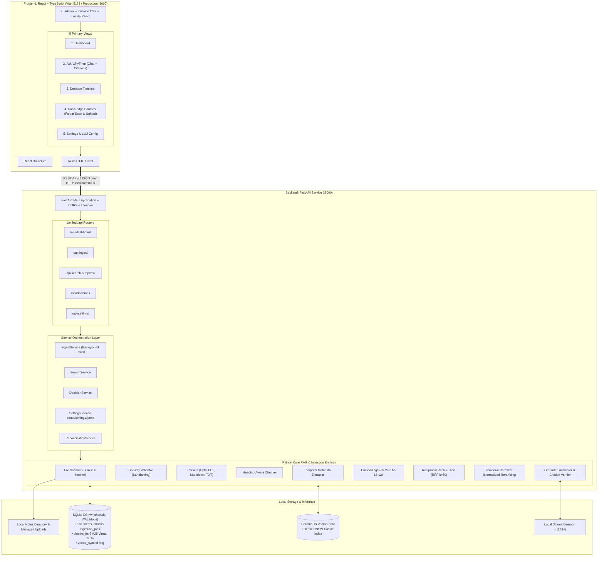
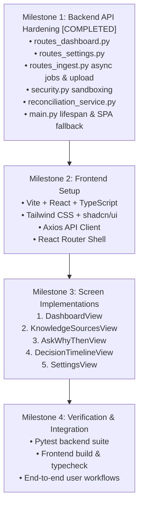

# WhyThen

A Local-First, Time-Aware Personal Memory & Decision History Assistant

TECHNICAL ARCHITECTURE DOCUMENT | React + TypeScript + FastAPI MVP

| Document Detail | Description |
| :--- | :--- |
| **Purpose** | Define the system architecture, components, data flow, storage model, APIs, frontend design, and implementation plan for WhyThen. |
| **Primary Use Case** | Search personal notes and project history by topic and time; reconstruct decisions, rationales, and changes of mind with verifiable source evidence. |
| **Design Principles** | Local-first, source-grounded, incremental indexing, temporal awareness, and explicit abstention when evidence is absent. |
| **Implementation Stack** | Frontend: React, TypeScript, Vite, Tailwind CSS, shadcn/ui, React Router, Axios, Lucide React.<br>Backend: Python 3.12, FastAPI, SQLite (FTS5 BM25), ChromaDB, Sentence Transformers, Ollama. |
| **Scope** | Single-user local desktop application; Markdown, TXT, and PDF files; no email/calendar sync, no cloud auth in MVP. |

---

## 1. Product Overview

WhyThen is a local-first personal knowledge assistant that helps users retrieve what they learned, planned, and decided over time. It incorporates timestamp metadata and decision history as primary query filtering and reranking dimensions.

### 1.1 Core Capabilities
1. **Multi-Source Ingestion**: Ingest notes via absolute local folder scanning (incremental SHA-256 hash detection) and browser-based multi-file upload (multipart/form-data to managed `data/uploads/` storage).
2. **Asynchronous Background Processing**: Ingestion returns `202 Accepted` with a `job_id` immediately; folder scanning and embedding generation execute off the event loop via background tasks with polling.
3. **Filesystem Security & Sandboxing**: Strict canonical path validation blocking traversal into operating system directories (`Windows`, `Program Files`, `.ssh`, `.aws`) and restricting CORS to local development origins.
4. **Heading-Aware Chunking**: Split content along markdown/structural boundaries (400–600 words with 60–80 word overlap) prepending section context.
5. **Hybrid Retrieval (Dense + Sparse FTS5 BM25)**: Pair dense embeddings with SQLite's native FTS5 full-text engine, fused via Reciprocal Rank Fusion (RRF $k=60$).
6. **Time-Aware Reranking**: Apply temporal fit weighting and hard date boundary filtering on coalesced effective dates ($0.50 \cdot \text{sem} + 0.30 \cdot \text{lex} + 0.20 \cdot \text{temporal}$).
7. **Query-Time Decision Lineage**: Dynamically synthesize chronological decision timelines (`initial_choice` $\rightarrow$ `revises` $\rightarrow$ `confirms`), with rationales and linked citations.
8. **Grounded Answer Generation & Abstention**: Answer questions with verified bracketed citations (`[chunk_id]`). If evidence is missing, returns coverage status `"no_evidence_found"`.
9. **Configurable Runtime Settings & Storage Atomicity**: Persistent configuration via `data/settings.json`, SQLite WAL mode, and startup reconciliation between SQLite chunks and ChromaDB vector store.

### 1.2 Non-Goals for the MVP
- No cloud synchronization, multi-user accounts, or OAuth/authentication layers.
- No external web scraping or automated editing/deletion of original user files.
- No asynchronous SSE / WebSockets streaming in the initial MVP.
- No eager graph database extraction during ingestion.

---

## 2. High-Level Architecture

### 2.1 System Topology
The system uses a decoupled client-server architecture:
- **Frontend SPA**: React + TypeScript client bundled by Vite, styled with Tailwind CSS and shadcn/ui.
- **Backend Service**: Python application running FastAPI + Uvicorn on localhost.
- **Data Persistence**: Local SQLite file (`data/sqlite/whythen.db`) and local ChromaDB directory (`data/chroma/`).



### 2.2 Component Responsibilities

| Component | Responsibility | Technology |
| :--- | :--- | :--- |
| **Frontend SPA** | Dashboard metrics, chat interface, citation drawer, chronological timeline, folder scan/upload forms, settings management. | React 18/19, TypeScript, Vite, Tailwind CSS, shadcn/ui, React Router, Axios, Lucide React. |
| **Backend API** | Typed HTTP JSON contracts under `/api/*`, input validation, CORS restricted to localhost:5173, static SPA hosting. | FastAPI, Pydantic v2, Uvicorn. |
| **Ingestion Pipeline** | Background scanning, SHA-256 change detection, multipart upload handling, format parsing, date extraction, chunking. | Python standard library, PyMuPDF, python-dateutil, python-multipart. |
| **Security Layer** | Path traversal protection, system directory sandboxing, upload filename sanitization, file size limits. | `app/security.py`. |
| **Keyword Search** | Exact phrase, identifier, and BM25 relevance ranking with automated triggers. | SQLite FTS5 (`unicode61` Porter tokenizer). |
| **Vector Search** | Dense semantic similarity matching and persistence. | ChromaDB (`hnsw:space: cosine`). |
| **Embeddings** | Local dense vector calculation for chunks and queries. | Sentence Transformers (`all-MiniLM-L6-v2`). |
| **Decision Lineage** | Chronological chunk sequencing, decision extraction, revision tracking, heuristic fallback. | Query-time LLM structured prompt + keyword heuristic. |
| **Generation & Grounding** | Strict context prompt assembly, Ollama communication, citation validation, abstention enforcement. | Python HTTP client, Ollama local daemon. |
| **Reconciliation Service** | Startup audit verifying SQLite chunks against ChromaDB vectors, backfilling unsynced vectors. | `app/services/reconciliation_service.py`. |

---

## 3. End-to-End Data Flows

### 3.1 Ingestion Flow: Asynchronous Folder Scan & File Upload
Two ingestion entry points route into a shared ingestion pipeline:
1. **Absolute Local Folder Scan (`POST /api/ingest/folder`)**:
   - The user inputs an absolute path (e.g. `C:\Users\...\notes`).
   - `validate_safe_directory` verifies path existence, permissions, and ensures it is not an OS system directory.
   - `JobRepository` creates an ingestion job record (`status='pending'`).
   - Background worker executes `ingest_folder_async` in a separate thread.
   - Computes SHA-256 hashes against SQLite `documents` table:
     - `unchanged`: Skipped.
     - `new` / `modified`: Text parsed, old chunks purged, re-chunked, embedded, and re-indexed.
     - `removed`: Cascading deletion from SQLite and ChromaDB.
   - Endpoint returns `202 Accepted` immediately with `job_id`.
2. **Browser Multipart Upload (`POST /api/ingest/upload`)**:
   - User drops files into the browser. Transmitted via `multipart/form-data`.
   - Backend validates file extensions (`.md`, `.txt`, `.pdf`) and enforces 25MB max size limit.
   - Sanitizes filenames and writes files into `data/uploads/`.
   - Creates ingestion job and dispatches `ingest_uploaded_files` to background worker.
   - Returns `202 Accepted` with `job_id`.

### 3.2 Query & Grounded Answer Flow (`POST /api/ask`)
1. User sends query string with optional date boundaries (`date_from`, `date_to`) and project filter.
2. `SearchService` executes dual retrieval in parallel:
   - **Dense Retrieval**: `embed_query()` &rarr; ChromaDB vector search ($2 \times \text{limit}$).
   - **Sparse Retrieval**: SQLite FTS5 `chunks_fts MATCH ...` ($2 \times \text{limit}$).
3. **Rank Fusion**: Fuses candidates using Reciprocal Rank Fusion ($k=60$):
   $$\text{RRF}(d) = \sum_{m \in \{\text{dense}, \text{sparse}\}} \frac{1}{60 + \text{rank}_m(d)}$$
4. **Hard Temporal Filtering**: Candidates with known `effective_date` falling strictly outside `[date_from, date_to]` are eliminated before ranking.
5. **Temporal Reranking**: Applies normalized scoring:
   $$\text{Score} = 0.50 \cdot \text{sem} + 0.30 \cdot \text{lex} + 0.20 \cdot \text{temporal}$$
6. **Grounded Generation**:
   - Constructs context pack with explicit excerpt tags: `[Excerpt chunk_id | File: path | Date: date]`.
   - Instructs Ollama to answer strictly using the context, citing `[chunk_id]`.
   - Validates that citations exist in the candidate set.
   - If no candidate chunks survive filtering or the question has no evidence, returns coverage status `"no_evidence_found"`.

### 3.3 Decision Lineage Flow (`GET /api/decisions/timeline`)
1. User queries a decision topic or tool (e.g., "Database", "Authentication").
2. `DecisionService` retrieves relevant chunks across time, capped at $N=15$ chunks to protect small-model context windows.
3. Chunks are strictly ordered chronologically by `event_date`.
4. Fed to the decision synthesis model to extract:
   - Topic summary
   - Chronological events with status: `initial_choice`, `revises`, `supersedes`, `confirms`
   - Explicit rationales and cited chunk IDs
5. If the LLM is unreachable or returns malformed JSON, a deterministic heuristic fallback identifies decision keywords and constructs the timeline safely.

---

## 4. Temporal Metadata & Date Hierarchy

WhyThen defines four temporal fields to establish event ordering:

| Field | Meaning | Resolution Priority |
| :--- | :--- | :--- |
| `event_date` | When the event, decision, or log took place. | 1. Explicit in text ("Decided on 2026-03-06") &rarr; `high` confidence.<br>2. General date in chunk ("March 6, 2026") &rarr; `medium` confidence.<br>3. Frontmatter date &rarr; `medium` confidence. |
| `document_date` | Date attributed to the document overall. | Frontmatter `date: YYYY-MM-DD` or filename date. |
| `modified_at` | Filesystem file modification timestamp. | Operating system file attribute; fallback signal. |
| `ingested_at` | When WhyThen indexed the file into storage. | Generated system timestamp. |

Effective date resolution for filtering:
$$\text{effective\_date} = \text{coalesce}(\text{event\_date}, \text{document\_date}, \text{modified\_at})$$

---

## 5. Storage Schema & Data Models

### 5.1 SQLite Tables (`data/sqlite/whythen.db`)

```sql
PRAGMA foreign_keys = ON;
PRAGMA journal_mode = WAL;
PRAGMA busy_timeout = 5000;

CREATE TABLE IF NOT EXISTS documents (
    id TEXT PRIMARY KEY,
    path TEXT UNIQUE NOT NULL,
    filename TEXT NOT NULL,
    content_hash TEXT NOT NULL,
    file_type TEXT NOT NULL,
    title TEXT,
    document_date TEXT,
    modified_at TEXT NOT NULL,
    ingested_at TEXT NOT NULL,
    status TEXT NOT NULL
);

CREATE TABLE IF NOT EXISTS chunks (
    id TEXT PRIMARY KEY,
    document_id TEXT NOT NULL REFERENCES documents(id) ON DELETE CASCADE,
    chunk_index INTEGER NOT NULL,
    text TEXT NOT NULL,
    heading TEXT,
    page_number INTEGER,
    event_date TEXT,
    date_confidence TEXT,
    source_path TEXT NOT NULL,
    title TEXT,
    vector_synced INTEGER DEFAULT 0
);

CREATE INDEX IF NOT EXISTS idx_chunks_document_id ON chunks(document_id);
CREATE INDEX IF NOT EXISTS idx_chunks_event_date ON chunks(event_date);
CREATE INDEX IF NOT EXISTS idx_documents_path ON documents(path);
CREATE INDEX IF NOT EXISTS idx_documents_content_hash ON documents(content_hash);

-- Full-Text Search (FTS5) table with BM25 support
CREATE VIRTUAL TABLE IF NOT EXISTS chunks_fts USING fts5 (
    id UNINDEXED,
    text,
    heading,
    title,
    source_path,
    tokenize = 'porter unicode61'
);

-- Triggers to keep FTS5 synchronized with chunks table
CREATE TRIGGER IF NOT EXISTS trg_chunks_insert AFTER INSERT ON chunks
BEGIN
    INSERT INTO chunks_fts(id, text, heading, title, source_path)
    VALUES (new.id, new.text, coalesce(new.heading, ''), coalesce(new.title, ''), new.source_path);
END;

CREATE TRIGGER IF NOT EXISTS trg_chunks_delete AFTER DELETE ON chunks
BEGIN
    DELETE FROM chunks_fts WHERE id = old.id;
END;

CREATE TRIGGER IF NOT EXISTS trg_chunks_update AFTER UPDATE ON chunks
BEGIN
    DELETE FROM chunks_fts WHERE id = old.id;
    INSERT INTO chunks_fts(id, text, heading, title, source_path)
    VALUES (new.id, new.text, coalesce(new.heading, ''), coalesce(new.title, ''), new.source_path);
END;

CREATE TABLE IF NOT EXISTS ingestion_jobs (
    id TEXT PRIMARY KEY,
    job_type TEXT NOT NULL DEFAULT 'folder',
    target_path TEXT,
    started_at TEXT NOT NULL,
    finished_at TEXT,
    status TEXT NOT NULL,
    files_processed INTEGER DEFAULT 0,
    total_files INTEGER DEFAULT 0,
    total_chunks INTEGER DEFAULT 0,
    error_summary TEXT
);
```

### 5.2 ChromaDB Collections & Embedding Schema
- **Collection Name**: `whythen_chunks`
- **Distance Metric**: Cosine (`hnsw:space: cosine`)
- **Metadata Fields**: `chunk_id`, `document_id`, `chunk_index`, `heading`, `event_date`, `date_confidence`, `source_path`, `title`.

### 5.3 Filesystem Storage Model
- `data/sqlite/whythen.db`: SQLite database file (WAL mode).
- `data/chroma/`: ChromaDB persistent index directory.
- `data/uploads/`: Managed directory for user-uploaded files.
- `data/settings.json`: Persistent application settings store.

---

## 6. REST API Contracts & TypeScript Interfaces

### 6.1 Endpoints Specification

| Method | Endpoint | Status | Description |
| :--- | :--- | :---: | :--- |
| `GET` | `/health` / `/api/health` | 200 | Application status, live Ollama probe, database health. |
| `GET` | `/api/dashboard/summary` | 200 | Aggregate metrics (documents, chunks, storage size, recent notes). |
| `POST` | `/api/ingest/folder` | 202 | Scans local absolute folder path asynchronously. |
| `POST` | `/api/ingest/upload` | 202 | Multipart form-data multi-file upload. |
| `GET` | `/api/ingest/jobs/{job_id}` | 200 | Polls ingestion job progress and status. |
| `GET` | `/api/ingest/documents` | 200 | Lists indexed documents with pagination (`limit`, `offset`). |
| `DELETE`| `/api/ingest/documents/{id}` | 200 | Cascading deletion of a document across SQLite, ChromaDB, and disk. |
| `POST` | `/api/search` | 200 | Raw hybrid search (dense + FTS5 BM25) with scores. |
| `POST` | `/api/ask` | 200 | Synchronous grounded Q&A with verifiable citations and coverage badge. |
| `GET` | `/api/decisions/timeline` | 200 | Query-time chronological decision lineage reconstruction. |
| `GET` | `/api/settings` | 200 | Current runtime settings and configuration. |
| `POST` | `/api/settings` | 200 | Validates and persists updated runtime settings. |
| `POST` | `/api/settings/reindex` | 200 | Triggers full re-indexing of all documents. |

### 6.2 TypeScript Contracts (`frontend/src/types/`)

```typescript
export type DocumentStatus = 'indexed' | 'modified' | 'removed' | 'failed';

export interface DocumentRecord {
  id: string;
  path: string;
  filename: string;
  content_hash: string;
  file_type: string;
  title: string | null;
  document_date: string | null;
  modified_at: string;
  ingested_at: string;
  status: DocumentStatus;
}

export interface DocumentListResponse {
  items: DocumentRecord[];
  total: int;
  limit: int;
  offset: int;
}

export interface SourceCitation {
  chunk_id: string;
  source_path: string;
  title: string | null;
  heading: string | null;
  event_date: string | null;
  document_date: string | null;
  excerpt: string;
  score: number;
}

export type CoverageStatus = 'supported' | 'partial' | 'no_evidence_found';

export interface AskRequest {
  question: string;
  date_from?: string | null;
  date_to?: string | null;
  project?: string | null;
  answer_mode?: 'standard' | 'decision_history' | 'unfinished_plans';
}

export interface AskResponse {
  answer: string;
  coverage: CoverageStatus;
  sources: SourceCitation[];
  timeline: DecisionTimelineItem[];
  limitations: string[];
}

export type DecisionRelation = 'initial_choice' | 'revises' | 'supersedes' | 'confirms';

export interface DecisionTimelineItem {
  event_date: string | null;
  decision: string;
  chosen_option: string | null;
  rationale: string | null;
  status_or_relation: DecisionRelation;
  citations: SourceCitation[];
}

export interface DecisionTimelineResponse {
  topic: string;
  summary: string;
  timeline: DecisionTimelineItem[];
  unresolved_questions: string[];
}

export interface IngestJobResponse {
  job_id: string;
  status: 'pending' | 'running' | 'completed' | 'failed';
  message: string;
}

export interface IngestJobStatus {
  id: string;
  job_type: 'folder' | 'upload';
  target_path: string | null;
  started_at: string;
  finished_at: string | null;
  status: 'pending' | 'running' | 'completed' | 'failed';
  files_processed: number;
  total_files: number;
  total_chunks: number;
  error_summary: string | null;
}

export interface DashboardSummaryResponse {
  total_documents: number;
  total_chunks: number;
  active_llm_model: string;
  embedding_model: string;
  storage_location: string;
  storage_size_bytes: number;
  recent_documents: DocumentRecord[];
  ollama_status: string;
}

export interface SettingsPayload {
  ollama_base_url: string;
  llm_model: string;
  embedding_model: string;
  knowledge_base_dir: string;
  upload_dir: string;
  top_k: number;
  timezone: string;
  chunk_size: number;
  chunk_overlap: number;
  semantic_weight: number;
  keyword_weight: number;
  temporal_weight: number;
  relevance_threshold: number;
}

export interface HealthStatusResponse {
  status: 'ok' | 'degraded';
  app: string;
  version: string;
  database: string;
  ollama: string;
}
```

---

## 7. Development & Production Deployment Strategy

### 7.1 Development Mode
- **Backend**: FastAPI runs on `http://localhost:8000` via Uvicorn with `--reload`.
- **Frontend**: Vite runs on `http://localhost:5173`.
- **Proxy**: `vite.config.ts` proxies `/api` and `/health` requests directly to `http://localhost:8000`.
- **CORS**: Restricted strictly to `http://localhost:5173` and `http://127.0.0.1:5173`.

### 7.2 Production Mode
- **Build**: Vite builds the production bundle into `frontend/dist`.
- **Serving**: FastAPI serves static assets and includes an SPA catch-all fallback route `@app.get("/{full_path:path}")` returning `frontend/dist/index.html` for any client route that does not match `/api/*` or `/health`.

---

## 8. Detailed Implementation Plan



### Milestone 1: Backend Hardening (Completed & Verified)
1. `[Create]` `app/security.py`: Local filesystem sandboxing and upload sanitization.
2. `[Create]` `app/services/reconciliation_service.py`: Startup reconciliation between SQLite and ChromaDB.
3. `[Create]` `app/services/settings_service.py`: Persistent configuration management in `data/settings.json`.
4. `[Create]` `app/schemas/dashboard.py`: Schema contract for dashboard summary.
5. `[Create]` `app/api/routes_dashboard.py`: Endpoint `GET /api/dashboard/summary`.
6. `[Create]` `app/api/routes_settings.py`: Endpoints `GET /api/settings`, `POST /api/settings`, and `POST /api/settings/reindex`.
7. `[Modify]` `app/api/routes_ingest.py`: Asynchronous folder scan, multipart upload, job status polling, and cascading document deletion.
8. `[Modify]` `app/api/main.py`: Unified `/api` prefix mounting, CORS origin restrictions, lifespan reconciliation, and SPA fallback route.
9. `[Modify]` `app/storage/database.py`: SQLite WAL mode, busy timeout, and `vector_synced` schema migration.
10. `[Modify]` `app/storage/repositories.py`: Added `JobRepository`, repository counting methods, and `vector_synced` tracking.
11. `[Modify]` `app/retrieval/reranker.py`: Normalized 3-weight scoring formula ($0.50 \cdot \text{sem} + 0.30 \cdot \text{lex} + 0.20 \cdot \text{temporal}$).
12. `[Modify]` `pyproject.toml`: Added `python-multipart>=0.0.9`.
13. `[Create]` `tests/test_regression_blockers.py`: Automated regression tests for all 7 blockers (10/10 tests passing).

### Milestone 2: React Frontend Initialization
1. `[Create]` Initialize Vite project in `frontend/` with React and TypeScript.
2. `[Create]` Configure Tailwind CSS, CSS variables, and Lucide icons.
3. `[Create]` Install shadcn/ui primitives (`Button`, `Card`, `Input`, `Badge`, `Sheet`, `Dialog`, `Table`, `Tabs`).
4. `[Create]` Set up React Router shell with persistent sidebar and header navigation.
5. `[Create]` Create centralized Axios client with 60s timeout and base URL configuration.

### Milestone 3: Screen Implementations
1. `[Create]` **Dashboard (`DashboardView.tsx`)**: Metrics grid (Documents, Chunks, Active Model, Storage), recent notes table, quick search.
2. `[Create]` **Knowledge Sources (`KnowledgeSourcesView.tsx`)**: Folder scan input with async job polling, drag-and-drop multi-file upload, document table with delete action.
3. `[Create]` **Ask WhyThen (`AskWhyThenView.tsx`)**: Conversational Q&A thread with date-range filters, coverage badge, and expandable citation drawer.
4. `[Create]` **Decision Timeline (`DecisionTimelineView.tsx`)**: Topic search bar, chronological vertical timeline, colored relation badges (`initial_choice`, `revises`, `supersedes`, `confirms`).
5. `[Create]` **Settings (`SettingsView.tsx`)**: Editable connection settings (Ollama URL, model, paths), advanced RAG parameters with re-index warning, read-only system diagnostics.

### Milestone 4: Verification & Integration
1. Verify Pytest suite passes (`pytest -v`).
2. Verify TypeScript compiler passes without errors (`tsc --noEmit`).
3. Verify Vite production build succeeds (`npm run build`).
4. Test full workflow: scan notes &rarr; upload file &rarr; ask date-constrained query &rarr; inspect decision timeline &rarr; verify settings persistence.
